# Tidradio TD-H9 Widget Installation Guide

[Open your hand.](README.md) | [UNBRICK MANUAL](README.en.md) | [RELEASES](https://github.com/dkxce/tdh9apps/releases)   
[Hands-to-hands.](APPLICATIONS.md) | [WIDGETS MANUAL](APPLICATIONS.en.md) | [RELEASES](https://github.com/dkxce/tdh9apps/releases)

Copy from[releases](https://github.com/dkxce/tdh9apps/releases) **custom**for
TIDRADIO TD-H9 with a set of tools for managing applications.

> In this instruction, the app menu opens**retention`#`**on the radio. No need to hold back.

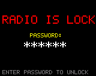 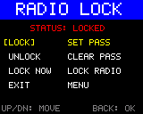 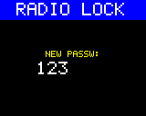   
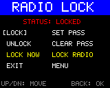 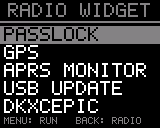 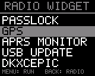

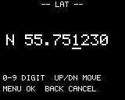 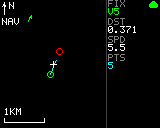 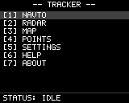   
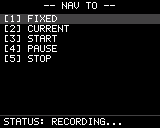 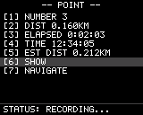 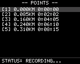   
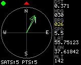 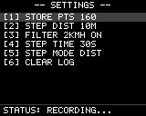 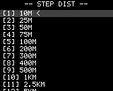

## What's in the archive?

| File. | Appointment |
| --- | --- |
| `firmware/*.fw` | **Custom firmware**(with support for password lock and application manager) |
| `firmware/Update App.exe` | official sewer`.fw`) |
| `h9_ui_flash.exe` | scatterer / scatterer through HID (`--help`for regimes) |
| `td9_apps.exe` | Application management (installation/removal)`.h9mod`) |
| `td9_kpi.exe` | loading`DKXCEPIC`) + setting/resetting the radio password |
| `td9_logo.exe` | boot-logo |
| `td9_aprs.exe` | read/write APRS/GNSS settings |
| `td9_tracksvr.exe` | editor/import/export of appendix points`TRACKER SAVER` |
| `myapps/*.h9mod` | finished application modules (`passlock`, `dkxcepic`, `bootscreen`, `tracking`, `tracksvr`) |
| `hidapi.dll` | Bluetooth communication library (should lie next to the`.exe`) |

---

# Part 1. For regular users (ready-made .exe)

You don't need any Python. It is enough to unpack the archive and run`.exe`.

## 1.1. Sweeve the custom firmware

1. Unpack the archive in a separate folder.
2. Go to the file.`firmware`.
3. Launch it.**`Update App.exe`**(official sewer).
4. Put the radio in firmware mode:**turn off**Hold it.**PTT + button`[2]`**And without letting go, turn on the walkie-talkie, and it's defined as an HID device.
   Or hold on to normal mode.**8**.
   Connect by USB (data transfer cable).
5. Select a file**`TD-H9-V1.0.38DKXCE.fw`**or**. fw**and press it.
6. Once completed, turn off the USB and turn off/on the radio.

> Make sure that the firmware is used, simple: retention`#`menu
> Applications (stock firmware does not have such a menu). Entering DTMF codes will be turned off.
> But first you have to install widgets.

## 1.2. Install applications (td9 apps.exe)

`td9_apps.exe`- console utility. Teams are entering**command-line
(cmd/PowerShell)**inside the archive folder.

Turn on the Bluetooth radio (radio menu → Bluetooth → inclusion / turn on), keep it close.

Show the available applications:

```
td9_apps.exe list
```

Identify the right names (names)`list`; the menu is set automatically:

```
td9_apps.exe install dkxcepic tracking tracksvr passlock
```

See what's established:

```
td9_apps.exe peek
```

Delete everything:

```
td9_apps.exe remove
```

After installation, open**menu**deterrence`#`- there will appear
installed modules.

> Tip: in order to password the radio, it is necessary to interpret the module`passlock`.

```
td9_apps.exe install passlock
```

## 1.3. Upload pictures to the radio (td9 kpi.exe)

Set a set of pictures for the viewer`DKXCEPIC`.

```
td9_kpi.exe check
td9_kpi.exe write photo1.png photo2.jpg
```

* Pictures are automatically compressed to 160×128 and converted to radio format.
* After recording, find**DKXCEPIC**in the application menu (retention)`#`:
  Up/Down, back, exit.

Delete the images:

```
td9_kpi.exe erase
```

## 1.4. Change the boot logo (td9 logo.exe)

The image you see when you turn on the radio.

Save the original first (important to return later):

```
td9_logo.exe read -o my-original-logo.bin
```

Record a new image:

```
td9_logo.exe write logo.png
```

> The picture will be reduced to 160×128; for smooth gradients add`--dither`:
> `td9_logo.exe write logo.png --dither`.

## 1.5. Set the radio password (td9 kpi.exe)

Custom firmware can block the radio with a password (if desired).

```
td9_kpi.exe pass --password 1234
```

* Password: 1 to 8 digits.
* After installation, turn off and turn on the radio: when turned on, ask for a password.
* Unlock:`td9_kpi.exe passclear`.

> Blocking works only with the installed application`passlock`.
> Don’t lose your password and keep Bluetooth on while you check that everything works.

```
td9_apps.exe install passlock
```

## 1.6. TRACKER SAVER points (td9 tracksvr.exe)

Editor of user points of the application`TRACKER SAVER`(see para.`myapps/tracksvr/README.md`).
Points read/write to sector`0x7FE000`Bluetooth.

```
td9_tracksvr.exe show          # показать точки из рации в консоль
td9_tracksvr.exe dump          # сохранить точки из рации в tracksvr_points.json
td9_tracksvr.exe load          # записать points.json в рацию (с бэкапом сектора)
```

* File format`tracksvr_points.json`: `{"points": [{"name": "HOME", "lat": 55.7558, "lon": 37.6173}, ...]}`;
  Custom way.`--file <путь>`.
* `load`erases the sector and writes the entire table; before erasing, saves
  old sector`tracksvr-sector-backup.bin`or`--backup <файл>`).
* The radio should be on, Bluetooth is active.

## 1.7. Reset the brick (h9 ui flash.exe)

If the radio stops loading, you can reflash it via HID:

```
h9_ui_flash.exe --help
```

---

# Part 2. For those who want to run Python scripts

The same functionality, but the original scripts`td9_apps.py`, `td9_kpi.py`,
`td9_logo.py`, `td9_aprs.py`, `td9_tracksvr.py`instead`.exe`.

## 2.1. Environment preparation

You need Python.**3. 10. +**(recommended 3.11) and`pip`.

```
# 1) Склонировать проект (или взять исходники из репозитория)
git clone https://github.com/dkxce/tdh9apps
cd tdh9apps

# 2) Создать виртуальное окружение и поставить зависимости
python -m venv .venv
.venv\Scripts\activate
pip install -r requirements.txt      # поэт: см. pyproject.toml / poetry install
```

The project is managed through**poetry**(if you have one):

```
poetry install
```

All further teams - through`poetry run python ...`(or directly if)
environment activated).

## Firmware (HID)

Flasher works via HID mode (PTT+2 when turned on):

```
poetry run python h9_flash.py --fw firmware/TD-H9-V1.0.38DKXCE.fw --backup before.bin
```

Flag reference:`h9_flash.py --help`.

## 2.3. Applications (td9 apps.py)

```
poetry run python td9_apps.py list
poetry run python td9_apps.py install dkxcepic bootscreen tracking
poetry run python td9_apps.py peek
poetry run python td9_apps.py remove
```

## Pictures (td9 kpi.py)

```
poetry run python td9_kpi.py check
poetry run python td9_kpi.py write photo1.png photo2.jpg
poetry run python td9_kpi.py erase
```

## Boot logo (td9 logo.py)

```
poetry run python td9_logo.py read -o my-original-logo.bin
poetry run python td9_logo.py write logo.png [--dither]
```

## 2.6. Password (td9 kpi.py)

```
poetry run python td9_kpi.py pass --password 1234
poetry run python td9_kpi.py passclear
```

## 2.7. APRS settings (td9 aprs.py)

```
poetry run python td9_aprs.py show
poetry run python td9_aprs.py get callsign
poetry run python td9_aprs.py set callsign R2AKA
```

## 2.8. TRACKER SAVER points (td9 tracksvr.py)

```
poetry run python td9_tracksvr.py show
poetry run python td9_tracksvr.py dump [--file tracksvr_points.json]
poetry run python td9_tracksvr.py load [--file tracksvr_points.json]
```

---

# Part 3. For those who want to build firmware and applications themselves

Everything is collected from your GitHub Actions source.

## 3.1. Structure of the project

```
tdh9apps/
├── firmware/            # исходный сток-пакет .fw для извлечения app.bin
├── custom_firmware/     # патчи: stub/, menu/ + CI прошивки
├── myapps/              # собственные модули: <app>/src/<app>.c
│   └── shared/          # общий слой (gfx, font, h9mod, ...)
├── .github/workflows/   # CI: сборка модулей и прошивки
└── *.py                 # скрипты-утилиты (td9_apps, td9_kpi, ...)
```

## 3.2. About assembly of modules (demo: new module)

Modules - C-files without libc, link under jeli-tulchain.
New Module = Just Create a Catalogue`.c`:

```
myapps/<app>/src/<app>.c      # функция module_main(const struct h9_api*, unsigned)
```

CI workflow`build-module.yml`(GitHub Actions) Downloads JieLi-Tulchain
release`toolchain`will`build_one.py <app>`give away`myapps/<app>.h9mod`.

Multi-track application - add`myapps/<app>/build.json`listed
modules and their sources (example -`myapps/tracking`).

Download yours:`td9_apps.py install <app>`.

## 3.3. About firmware assembly

The firmware is assembled in CI (`build-lock-firmware.yml`): runoff is taken`firmware/TD-H9-V1.0.38.fw`from it is extracted`app.bin`superimposed
yours`custom_firmware/stub/stub.s`(patch) placed`custom_firmware/menu/menu.c`.
And the firmware is assembled with a built-in application manager.

Locally (without GitHub) - see`custom_firmware/README.md`:

```
JIELI_TOOLCHAIN=<toolchain> python -I firmware-research/.../build.py \
  --stock-image <app.bin> --stock-package <fw>
```

## 3.4 Application menu assembly

The application menu is collected in the same CI as the firmware (`build-lock-firmware.yml`:
For its correct assembly, you need an actual stub.

## 3.5. Lock stack and modules (memory)

* `menu.h9mod`(module 0) - list of applications; mandatory for the menu`#`.
* `passlock.h9mod`Password entry screen; works with`menu.h9mod`and stub firmware. Lock flag`skip_check`satshare`0x2B8DF`.
* RAM slot module:`0x29F00..0x2BEFF`(8 KB); tracker status under
  mailbox`0x2BEE0` (`struct trk`, `STATE_BYTES=0x6F4`).

---

## Requirements and observations

* **Bluetooth**for everyone`.exe`/`.py`(Apart from the HID, the radio should be
  switched on, Bluetooth active, radio next to PC.
* **hidapi**: should lie next to`.exe`(It is already in the archive.)
* When using lock firmware, keep Bluetooth on until
  don't make sure`pass`/`passclear`They work well.
* Retention`#`Opens the app menu. Modules installed through`td9_apps`They appear on this menu.

---

## Annex: addresses and anchorages (briefly)

| What? | Meaning. |
| --- | --- |
| Image area of DKXCEPIC | resource`0x717000` |
| Points Tracker Saver | resource`0x7FE000`(4 KiB, magic)`DKXCETRACKSAVES`) |
| Boot logo | resource`0xA00000`(160×128 RGB565) |
| Lock flag`skip_check` | Ram.`0x2B8DF` |
| Modules | resource`0xCC0000`(catalogue), data`0xCC1000` |
| RAM slot module | `0x29F00..0x2BEFF`(8 KB) |

## Real Photos

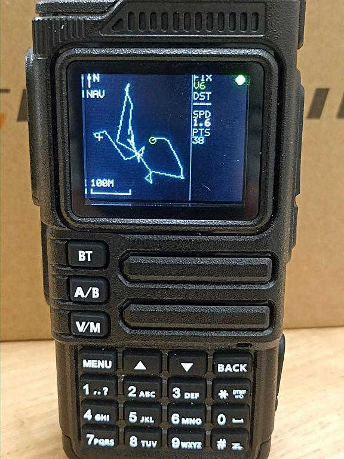

---

## Credits & Acknowledgments

Applications are based on tulbox and custom firmware[melidosian/h9toolbox](https://github.com/melidosian/h9toolbox).

---

**Author**: [dkxcece](https://github.com/dkxce)   
**Android**: [dkxce/tdh9android](https://github.com/dkxce/tdh9android)   
**Desktop**: [dkxce/tdh9desktop](https://github.com/dkxce/tdh9desktop)   
**Manual**: [dkxce/Tidradio-TD-H9](https://github.com/dkxce/Tidradio-TD-H9)