# Game Collection (11 games) - TIDRADIO TD-H9

[Open your hand.](UNBRICK.md) | [UNBRICK MANUAL](UNBRICK.en.md) | [RELEASES](https://github.com/dkxce/tdh9apps/releases)   
[Hand-to-hand stitching](custom_firmware/README.md) | [Custom Fireware Manual](custom_firmware/README.en.md) | [RELEASES](https://github.com/dkxce/tdh9apps/releases)   
[Hands-to-hands.](APPLICATIONS.md) | [WIDGETS MANUAL](APPLICATIONS.en.md) | [RELEASES](https://github.com/dkxce/tdh9apps/releases)   
[Hand-to-hand games](GAMES.md) | [GAMES MANUAL](GAMES.en.md) | [RELEASES](https://github.com/dkxce/tdh9apps/releases)

Collection of game widgets for radio**TIDRADIO TD-H9**(castom firmware with
Application manager. All modules are flooded as`.h9mod`by Bluetooth (see para.[installation](#установка)).

## Collection

| # | Game. | `.h9mod` |
| --- | --- | --- |
| 1 | 8 ball pool | `8ballpool.h9mod` |
| 2 | Battle City | `battlecity.h9mod` |
| 3 | Bomberman | `bomberman.h9mod` |
| 4 | Bomberman 2 | `bomberman2.h9mod` |
| 5 | Load Runner | `loadrunner.h9mod` |
| 6 | Mineswiper | `mineswiper.h9mod` |
| 7 | Othello | `othello.h9mod` |
| 8 | Sea Fight (CPU + APRS Dual Mode) | `seafight.h9mod` |
| 9 | Snake. | `snake.h9mod` |
| 10 | Tetris | `tetris.h9mod` |
| 11 | Aprs Pool (Local + APRS Dual Mode) | `aprspool.h9mod` |

---

## 1. 8 Ball Pool

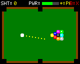 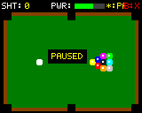 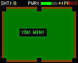

Classic pool. Ten balls (white bit + 8 colored + black eight) on
green cloth. Turn the sight, set the force of the impact and hit the bat. Victory to score
The black ball (8th) is the last; if the 8th flies into the hole, while there are colored -**foul**and losing.

| Button | Action. |
| --- | --- |
| `4` / `6` | left-right |
| `1` / `3` | angle adjustment |
| `2` / `8` | stronger/weaker |
| `5` | hitting the bat (in sight stages) |
| `*` | pause |
| `Back` | menu |

---

## 2. Battle City.

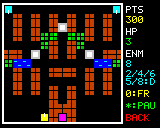 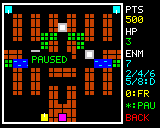 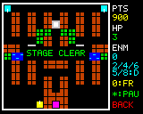 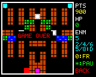

The tank arcade. We defend our headquarters (eagle) at the bottom of the map from three enemy tanks.
35 levels. Tile: brick (destructible), steel (indestructible), water (tanks not)
They pass, shells fly by, forest (mask objects). +100 for the enemy, the player
3 lives.

| Button | Action. |
| --- | --- |
| `2` / `8`or`5`) | up |
| `4` / `6` | left/right |
| `0` | shot |
| `*` | pause |
| `Back` | exit |

---

## 3. Bomberman.

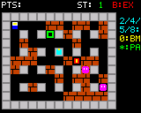 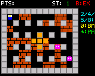 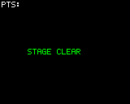 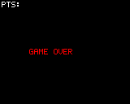

Classic bomberman. We plant bombs, we destroy bricks.
Find a hidden door and bonus`+1 к радиусу взрыва`. Destroy all 4 enemies,
Enter the door to move to the next level. Getting hit by an explosion or an enemy
loss.

| Button | Action. |
| --- | --- |
| `2` / `8`or`5`) | up |
| `4` / `6` | left/right |
| `0` | bomb |
| `*` | pause |
| `Back` | exit |

---

## 4. Bomberman 2.

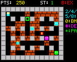 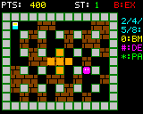 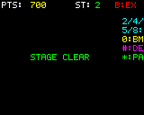 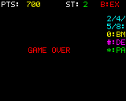

An extended version of the bomberman. Up to 3 simultaneous bombs, manual detonator (keyboard)`#`), passing through bricks. Three types of enemies: pink ball (ordinary), blue
Hunter (follows the line), green ghost (walks through bricks). 4 replaceable
Color themes of the field, enemies more and more with increasing level.

| Button | Action. |
| --- | --- |
| `2` / `8`or`5`) | up |
| `4` / `6` | left/right |
| `0` | bomb |
| `#` | manual detonation (if there is a detonator) |
| `*` | pause |
| `Back` | exit |

---

## 5. Load Runner

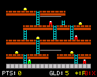 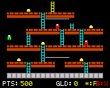 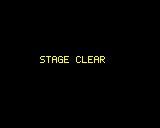 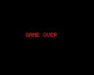

Ice runner on stairs and crossbars. We collect all the gold, it opens.
There is a hidden exit (yellow stairs up), we get to it. Guards chasing
They can be caught by burning a brick so that they fall into a hole. 12 levels.

| Button | Action. |
| --- | --- |
| `4` / `6` | left/right |
| `2` | climb |
| `8`or`5`) | downhill |
| `1` / `7` | pit |
| `3` / `9` | pit |
| `*` | pause |
| `Back` | exit |

---

## 6. Mineswiper

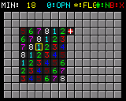 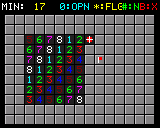 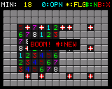 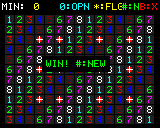

Sapper. Field 15x11, 22 mines. The first move is always safe (mines are not placed in the zone).
3×3 around the cursor. Open cells show the number of mines around the wave
The algorithm opens up empty areas. Victory - open all the cells without mines.

| Button | Action. |
| --- | --- |
| `2` / `8`or`5`) | cursor |
| `4` / `6` | left/right |
| `0` | open |
| `*` | flag |
| `#` | play |
| `Back` | exit |

---

## 7. Othello

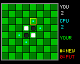 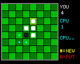 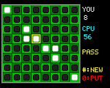   
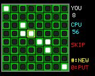 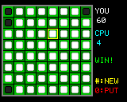 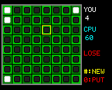

Reversi (Othello) vs. AI. Board 8×8, player – white chips, CPU – black. AI
assesses the position by weights of cells (corners are the most valuable) and flips the captured ones
chips. Blue dots are clues to the available moves. End by chip count.
(WIN/LOSE/DRAW).

| Button | Action. |
| --- | --- |
| `2` / `8`or`5`) | cursor |
| `4` / `6` | left/right |
| `0` | chip |
| `#` | play |
| `Back` | exit |

---

## 8. Sea Fight (CPU + APRS Dual Mode)

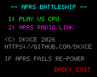 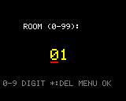 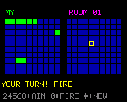   
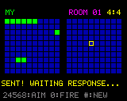 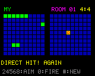 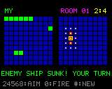   
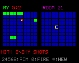 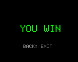 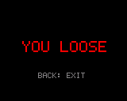

Battleship. Two modes:**1 - Play vs CPU**(play against radio) and**2 - APRS
Radio Link**(Playing by radio via APRS, rooms 0-99) Two 10x10 fields. System system
Guidance, hits and sinkings.

| Button | Action. |
| --- | --- |
| `2` / `8` | cursor |
| `4` / `6` | left/right |
| `5` | confirm (room entry) |
| `0` | shot |
| `#` | play |
| `Back` | exit |

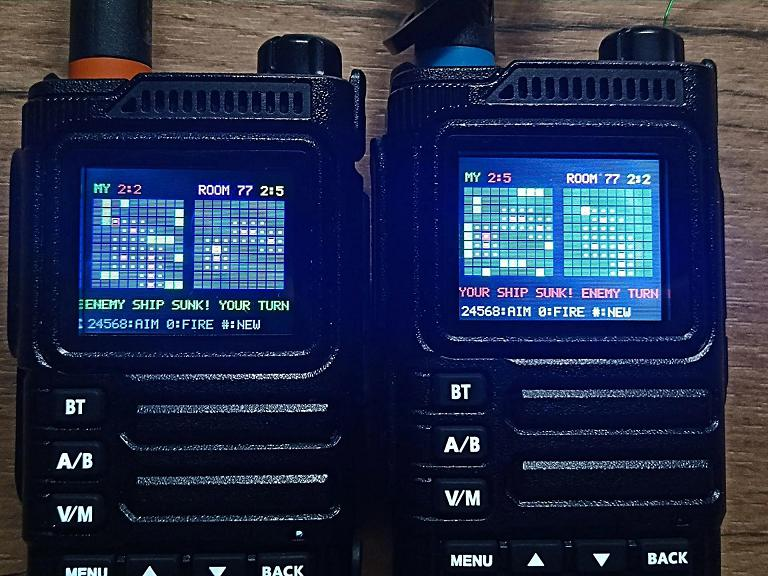

---

## 9. Snake.

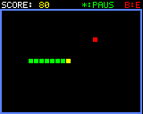 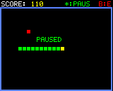 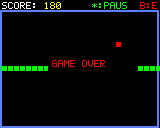

Classic snake. 26x19 field. We collect red apples (+10) and the snake grows.
accelerates (step from 180 to 60 ms). Collision with a wall or its own tail
loss.

| Button | Action. |
| --- | --- |
| `2` / `8`or`5`) | up |
| `4` / `6` | left/right |
| `*` | pause |
| `Back` | exit |

---

## 10. Tetris

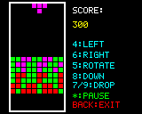 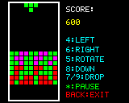 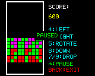 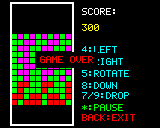

Tetris. 10×20 glass, 7 classical shapes (I, O, T, S, Z, J, L) with rotation and
"kick-stee." The completed row is removed (+100 points). Autofall once in 0.5 seconds,
instantaneous discharge (`7/9`), pause (`*`).

| Button | Action. |
| --- | --- |
| `4` / `6` | left/right |
| `5` | turn |
| `8` | downhill |
| `7` / `9` | drop-down |
| `*` | pause |
| `Back` | exit |

---

## 11. Aprs Pool (Local + APRS Dual Mode)

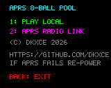  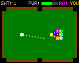   
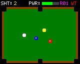 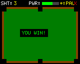 

Pool 8 with two modes.**1 - Play Local**- local play
(one player, foul balls).**2 - APRS RADIO LINK**- radio game through
APRS in room 0-99: after impact, the state of the balls is synchronized (SYNC),
transmitted to the opponent (`YOU` / `WT`). Winning - to score the black 8th last; if
8 goes into the hole early.`8-BALL FOUL`and losing.

| Button | Action. |
| --- | --- |
| `4` / `6` | left-right |
| `1` / `3` | angle adjustment |
| `2` / `8` | stronger/weaker |
| `0`or`5`locally | punch |
| `*` | pause (only in local mode) |
| `Back` | exit |

---

## Installation

### Option A - ready-made`exe`(without Python)

1. Download games and customized firmware in[releases](https://github.com/dkxce/tdh9apps/releases)
2. Put it on the radio.**custom**is`firmware/`through`Update App.exe`or`h9_ui_flash.exe`) — otherwise, the application menus and widgets do not work.
3. Put it on the radio.**Bluetooth**(radio menu → Bluetooth → included), keep the radio next to you.
4. Copy the right ones.`.h9mod`folder`myapps`programme`td9_apps.exe`and set them up:

```
td9_apps.exe install 8ballpool battlecity bomberman bomberman2 loadrunner mineswiper othello seafight snake tetris
```

The app menu is automatically installed. Take a look at this.

```
td9_apps.exe peek
```

### Option B - from source (Python + poetry)

```
poetry install
poetry run python td9_apps.py install 8ballpool battlecity bomberman bomberman2 loadrunner mineswiper othello seafight snake tetris
```

### After installation

Open up.**menu** — **retention`#`**on the radio. The list will appear
Installed games, go to the right buttons`🡅`/`🡇`and confirm`MENU`.

> Retention`#`Opens the app menu; you don’t need to hold back.

## Credits & Acknowledgments

Games are based on tulbox and custom firmware[melidosian/h9toolbox](https://github.com/melidosian/h9toolbox).

---

**Author**: [dkxcece](https://github.com/dkxce)   
**Android**: [dkxce/tdh9android](https://github.com/dkxce/tdh9android)   
**Desktop**: [dkxce/tdh9desktop](https://github.com/dkxce/tdh9desktop)   
**Widgets**: [dkxce/tdh9apps](https://github.com/dkxce/tdh9apps)   
**Manual**: [dkxce/Tidradio-TD-H9](https://github.com/dkxce/Tidradio-TD-H9)