# Game Collection (10 игр) — TIDRADIO TD-H9

[РАЗКИРПИЧИТЬ РУК-ВО](README.md) | [UNBRICK MANUAL](README.en.md) | [RELEASES](https://github.com/dkxce/tdh9apps/releases)            
[ВИДЖЕТЫ РУК-ВО](APPLICATIONS.md) | [WIDGETS MANUAL](APPLICATIONS.en.md) | [RELEASES](https://github.com/dkxce/tdh9apps/releases)             
[ИГРЫ РУК-ВО](GAMES.md) | [GAMES MANUAL](GAMES.en.md) | [RELEASES](https://github.com/dkxce/tdh9apps/releases)         

Коллекция игровых виджетов для рации **TIDRADIO TD-H9** (кастомная прошивка с
менеджером приложений). Все модули заливаются как `.h9mod` по Bluetooth (см. [инструкцию установки](#установка)).

## Состав коллекции

| # | Игра | `.h9mod` |
|---|------|----------|
| 1 | 8 ball pool | `8ballpool.h9mod` |
| 2 | Battle City | `battlecity.h9mod` |
| 3 | Bomberman | `bomberman.h9mod` |
| 4 | Bomberman 2 | `bomberman2.h9mod` |
| 5 | Load Runner | `loadrunner.h9mod` |
| 6 | Mineswiper | `mineswiper.h9mod` |
| 7 | Othello | `othello.h9mod` |
| 8 | Sea Fight | `seafight.h9mod` |
| 9 | Snake | `snake.h9mod` |
| 10 | Tetris | `tetris.h9mod` |

---

## 1. 8 Ball Pool

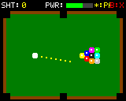 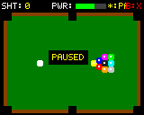 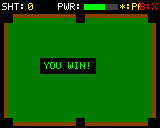

Классический пул. Десять шаров (белый биток + 8 цветных + чёрная восьмёрка) на
зелёном сукне. Вращаем прицел, задаём силу удара и бьём по битку. Победа — забить
чёрный шар (8-ку) последним; если 8-ка залетает в лузу, пока есть цветные —
**фол** и проигрыш.

| Кнопка | Действие |
|---|---|
| `4` / `6` | вращать прицел влево / вправо |
| `1` / `3` | точная подстройка угла |
| `2` / `8` | сильнее / слабее удар |
| `5` | удар по битку (в стадиях прицела) |
| `*` | пауза |
| `Back` | выход в меню |

---

## 2. Battle City

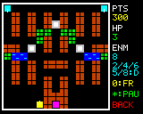 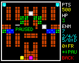 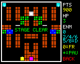 77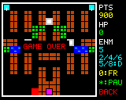

Аркада про танки. Защищаем свой штаб (орёл) внизу карты от трёх вражеских танков.
35 уровней. Тайлы: кирпич (разрушаемый), сталь (неразрушаемая), вода (танки не
проедут, снаряды пролетают), лес (маскирует объекты). Счёт +100 за врага, у игрока
3 жизни.

| Кнопка | Действие |
|---|---|
| `2` / `8`(или `5`) | вверх / вниз |
| `4` / `6` | влево / вправо |
| `0` | выстрел |
| `*` | пауза |
| `Back` | выход |

---

## 3. Bomberman

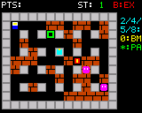 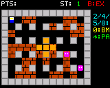 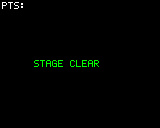 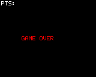

Классический бомбермен. Ставим бомбы (взрывают крестом), разрушаем кирпичи,
находим спрятанные дверь и бонус `+1 к радиусу взрыва`. Уничтожаем всех 4 врагов,
входим в дверь для перехода на следующий уровень. Попадание под взрыв или врага —
проигрыш.

| Кнопка | Действие |
|---|---|
| `2` / `8`(или `5`) | вверх / вниз |
| `4` / `6` | влево / вправо |
| `0` | поставить бомбу |
| `*` | пауза |
| `Back` | выход |

---

## 4. Bomberman 2

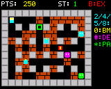 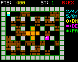 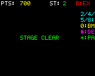 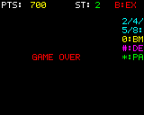

Расширенная версия бомбермена. До 3 одновременных бомб, ручной детонатор (клавиша
`#`), проход сквозь кирпичи. Три вида врагов: розовый шарик (обычный), синий
охотник (преследует по линии), зелёный призрак (ходит сквозь кирпичи). 4 сменяемых
цветовых темы поля, врагов всё больше с ростом уровня.

| Кнопка | Действие |
|---|---|
| `2` / `8`(или `5`) | вверх / вниз |
| `4` / `6` | влево / вправо |
| `0` | поставить бомбу |
| `#` | ручной подрыв (если есть детонатор) |
| `*` | пауза |
| `Back` | выход |

---

## 5. Load Runner

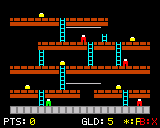 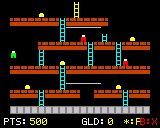 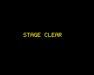 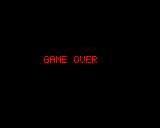

Ледяной бегун по лестницам и перекладинам. Собираем всё золото — открывается
скрытый выход (жёлтая лестница наверх), добираемся до него. Охранники гоняются за
игроком; их можно поймать, прожигая кирпич так, чтобы они падали в яму. 12 уровней.

| Кнопка | Действие |
|---|---|
| `4` / `6` | влево / вправо |
| `2` | подняться по лестнице |
| `8` (или `5`) | вниз |
| `1` / `7` | прожигать яму слева |
| `3` / `9` | прожигать яму справа |
| `*` | пауза |
| `Back` | выход |

---

## 6. Mineswiper

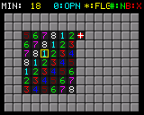 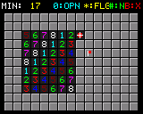 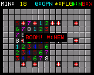 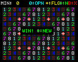

Сапёр. Поле 15×11, 22 мины. Первый ход всегда безопасен (мины не ставятся в зоне
3×3 вокруг курсора). Открытые клетки показывают количество мин вокруг, волновой
алгоритм открывает пустые области. Победа — открыты все клетки без мин.

| Кнопка | Действие |
|---|---|
| `2` / `8`(или `5`) | курсор вверх / вниз |
| `4` / `6` | курсор влево / вправо |
| `0` | открыть клетку |
| `*` | поставить / снять флажок |
| `#` | новая игра |
| `Back` | выход |

---

## 7. Othello

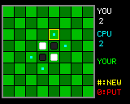 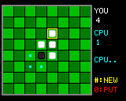 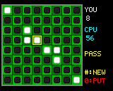     
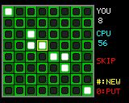 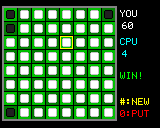 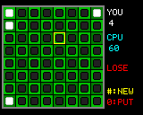     

Реверси (Отелло) против ИИ. Доска 8×8, игрок — белые фишки, CPU — чёрные. ИИ
оценивает позицию по весам клеток (углы самые ценные) и переворачивает захваченные
фишки. Голубые точки — подсказки доступных ходов. Конец — по числу фишек
(WIN/LOSE/DRAW).

| Кнопка | Действие |
|---|---|
| `2` / `8`(или `5`) | курсор вверх / вниз |
| `4` / `6` | курсор влево / вправо |
| `0` | поставить фишку |
| `#` | новая игра |
| `Back` | выход |

---

## 8. Sea Fight

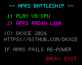 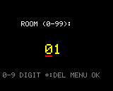 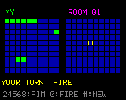    
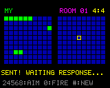 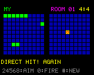 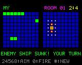     
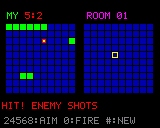 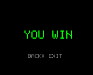 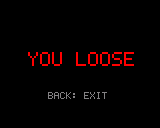    

«Морской бой». Два режима: **1 — PLAY VS CPU** (игра против рации) и **2 — APRS
RADIO LINK** (игра по рации через APRS, комнаты 0–99). Два поля 10×10. Система
наведения, попаданий и потоплений.

| Кнопка | Действие |
|---|---|
| `2` / `8` | курсор вверх / вниз |
| `4` / `6` | курсор влево / вправо |
| `5` | подтвердить (ввод комнаты) |
| `0` | выстрел |
| `#` | новая игра |
| `Back` | выход |

---

## 9. Snake

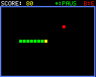 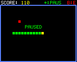 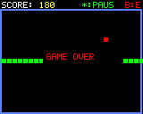

Классическая змейка. Поле 26×19. Собираем красные яблоки (+10), змейка растёт и
ускоряется (шаг от 180 до 60 мс). Столкновение со стеной или собственным хвостом —
проигрыш.

| Кнопка | Действие |
|---|---|
| `2` / `8`(или `5`) | вверх / вниз |
| `4` / `6` | влево / вправо |
| `*` | пауза |
| `Back` | выход |

---

## 10. Tetris

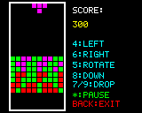 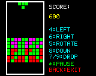 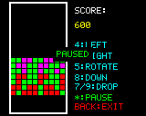 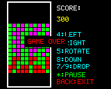

Тетрис. Стакан 10×20, 7 классических фигур (I, O, T, S, Z, J, L) с поворотом и
«кик-стью». Заполненный ряд убирается (+100 очков). Автопадение раз в 0.5 с,
мгновенный сброс (`7/9`), пауза (`*`).

| Кнопка | Действие |
|---|---|
| `4` / `6` | влево / вправо |
| `5` | поворот |
| `8` | вниз |
| `7` / `9` | мгновенный сброс вниз |
| `*` | пауза |
| `Back` | выход |

---

## Установка

### Вариант A — готовые `.exe` (без Python)

1. Прошейте в рацию **кастомную прошивку** (из `firmware/` через `Update App.exe`
   или `h9_ui_flash.exe`) — иначе меню приложений и виджеты не работают.
2. Включите на рации **Bluetooth** (меню рации → Bluetooth → вкл.), держите рацию рядом.
3. Скопируйте нужные `.h9mod` в папку архива `myapps` и установите их:

```
td9_apps.exe install 8ballpool battlecity bomberman bomberman2 loadrunner mineswiper othello seafight snake tetris
```

Меню приложений ставится автоматически. Посмотреть установленное:
```
td9_apps.exe peek
```

### Вариант B — из исходников (Python + poetry)

```powershell
poetry install
poetry run python td9_apps.py install 8ballpool battlecity bomberman bomberman2 loadrunner mineswiper othello seafight snake tetris
```

### После установки

Откройте **меню приложений** — **удержание `#`** на рации. В списке появятся
установленные игры, заходите в нужную кнопками `2`/`8` и подтверждайте.

> Удержание `#` открывает меню приложений; Back удерживать не нужно.

## Credits & Acknowledgments

Игры основаны на тулбоксе и кастомной прошивке [melidosian/h9toolbox](https://github.com/melidosian/h9toolbox).    

---

**Автор**: [dkxce](https://github.com/dkxce)     
**Android**: [dkxce/tdh9android](https://github.com/dkxce/tdh9android)      
**Desktop**: [dkxce/tdh9desktop](https://github.com/dkxce/tdh9desktop)      
**Widgets**: [dkxce/tdh9apps](https://github.com/dkxce/tdh9apps)      
**Manual**: [dkxce/Tidradio-TD-H9](https://github.com/dkxce/Tidradio-TD-H9)  