Tidradio TD-H9 Customization

#### Tidradio TD-H9 Customization: HID Unbricker + Custom Firmware + Apps + Games

---

**Quick links**:   
- [RU](README.md) | [EN](README.en.md)   
- [Open your hand.](UNBRICK.md) | [UNBRICK MANUAL](UNBRICK.en.md)   
- [Hand-to-hand stitching](custom_firmware/README.md) | [Custom Fireware Manual](custom_firmware/README.en.md)   
- [Hands-to-hands.](APPLICATIONS.md) | [WIDGETS MANUAL](APPLICATIONS.en.md)   
- [Hand-to-hand games](GAMES.md) | [GAMES MANUAL](GAMES.en.md)
- [INSTRUCTION](https://github.com/dkxce/Tidradio-TD-H9/blob/main/TD-H9_manual.ru.md) | [MANUAL](https://github.com/dkxce/Tidradio-TD-H9/blob/main/TD-H9_manual.en.md)
- [OTHER DOC-IA AND SOFT](https://github.com/dkxce/Tidradio-TD-H9/blob/main/README.md) | [OTHER DOCS & SOFT](https://github.com/dkxce/Tidradio-TD-H9/blob/main/README.md)   
- [RELEASES](https://github.com/dkxce/tdh9apps/releases)

---

**Contents**:
-[Description of the repository](#описание)   
- [Documentation](#документация-md)   
- [Screenshots](#скриншоты-экранов-виджетов-приложений)

---

## Description

This repository is a set of tools and firmware for**radio station TIDRADIO
TD-H9**. Here is everything that relates to working with the radio:

* **Unbrick**Decomposition of the main flash memory in**HID mode**(without switching the chip to UBOOT mode). Includes console flasher`h9_flash.py`window appendix`ui_app/app.py`(PySide6) that are unpacked
  packet`.fw`Compare CRC sectors and rewrite only different ones.
* **Custom firmware**Custom firmware with password support
  ?`custom_firmware/`), as well as utilities for changing the boot logo, downloading
  Images and app firmware.
* **Apps**- applications / widgets for walkie-talkie (menu, tracker, waypoints,
  Password and other modules.
* **Games**Radio games (such as naval combat).
* **Python scripts**A set of automation scripts:`h9_flash.py`,
  `td9_aprs.py`(APRS/GNSS settings),`td9_apps.py`, `td9_logo.py`,
  `td9_kpi.py`etc.

> **What an unbrick tool does.**Unpacking the bag`.fw`(extracts)`flash.bin`), compares the CRC sectors of the radio to the target image and overwrites**differing**sectors, then checks the record by CRC. Boot area`0x0000..0x4FFF`settings`0xDA000..0x100000` **hold off**.

---

## Documentation`. md`)

| Document | RU | EN |
| --- | --- | --- |
| Description of the repository (this file) | [Readme. md](README.md) | [Readme.en. md](README.en.md) |
| **UNBRICK**: HID piping | [UNBRICK. md](UNBRICK.md) | [UNBRICK.EN. md](UNBRICK.en.md) |
| Custom firmware | [custom firmware/README. md](custom_firmware/README.md) | [custom firmware/README.en. md](custom_firmware/README.en.md) |
| Annexes/widgets | [Applications. md](APPLICATIONS.md) | [Applications.en. md](APPLICATIONS.en.md) |
| Installation of applications | [td9 apps. md](td9_apps.md) | [td9 apps.en. md](td9_apps.en.md) |
| Passing the radio | [lock-pass. md](lock-pass.md) | [lock-pass.en. md](lock-pass.en.md) |
| Games | [GAMES. md](GAMES.md) | [GAMES.EN. md](GAMES.en.md) |
| Boot logo | [td9 logo. md](td9_logo.md) | [td9 logo.en. md](td9_logo.en.md) |
| Picture package | [td9 kpi. md](td9_kpi.md) | [td9 kpi.en. md](td9_kpi.en.md) |
| APRS/GNSS settings | [td9 aprs. md](td9_aprs.md) | — |
| tracker | [myapps/tracking/README. md](myapps/tracking/README.md) | [myapps/tracking/README.en. md](myapps/tracking/README.en.md) |
| Travel points | [myapps/tracksvr/README. md](myapps/tracksvr/README.md) | [myapps/tracksvr/README.en. md](myapps/tracksvr/README.en.md) |
| Tracker restrictions | [myapps/tracking/LIMITS. md](myapps/tracking/LIMITS.md) | [myapps/tracking/LIMITS.en. md](myapps/tracking/LIMITS.en.md) |
| Memory map | [ram. md](ram.md) | [ram.en. md](ram.en.md) |

---

## Screenshots of application widget screens

### Menu and Passwordsman

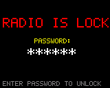 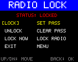 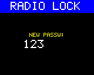   
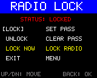 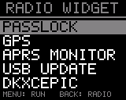 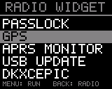

### Tracking

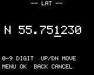 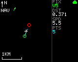 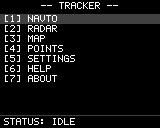   
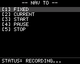 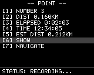 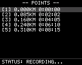   
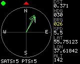 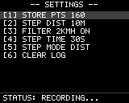 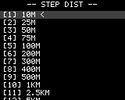

### Real Photos

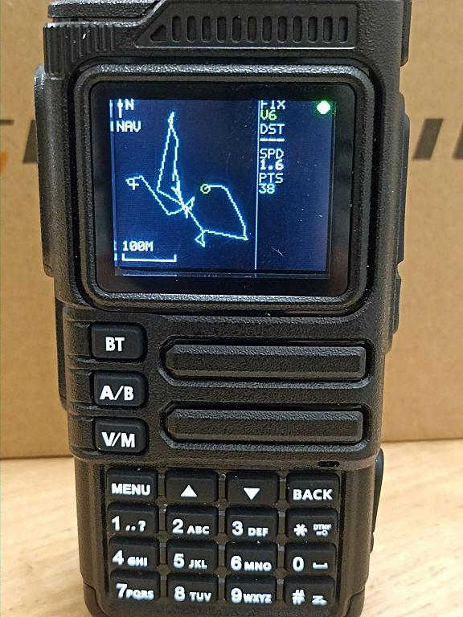

---

## Credits & Acknowledgments

Applications are based on tulbox and custom firmware[melidosian/h9toolbox](https://github.com/melidosian/h9toolbox).

---

**Author**: [dkxcece](https://github.com/dkxce)   
**Android**: [dkxce/tdh9android](https://github.com/dkxce/tdh9android)   
**Desktop**: [dkxce/tdh9desktop](https://github.com/dkxce/tdh9desktop)   
**Widgets**: [dkxce/tdh9apps](https://github.com/dkxce/tdh9apps)   
**Manual**: [dkxce/Tidradio-TD-H9](https://github.com/dkxce/Tidradio-TD-H9)