# Tidradio TD-H9 Customization
#### Tidradio TD-H9 Customization: HID Unbricker + Custom Firmware + Apps + Games

---

**Quick links**:     
- [RU](README.md) | [EN](README.en.md)      
- [РАЗКИРПИЧИТЬ РУК-ВО](UNBRICK.md) | [UNBRICK MANUAL](UNBRICK.en.md)      
- [КАСТОМНАЯ ПРОШИВКА РУК-ВО](custom_firmware/README.md) | [CUSTOM FIRMWARE MANUAL](custom_firmware/README.en.md)releases)            
- [ВИДЖЕТЫ РУК-ВО](APPLICATIONS.md) | [WIDGETS MANUAL](APPLICATIONS.en.md)              
- [ИГРЫ РУК-ВО](GAMES.md) | [GAMES MANUAL](GAMES.en.md)      
- [RELEASES](https://github.com/dkxce/tdh9apps/releases)      

---

**Содержание**:
- [ОПИСАНИЕ РЕПОЗИТОРИЯ](#описание)     
- [ДОКУМЕНТАЦИЯ](#документация-md)          
- [СКРИНШОТЫ](#скриншоты-экранов-виджетов-приложений)

---        

## Описание

Этот репозиторий — набор инструментов и прошивок для **радиостанции TIDRADIO
TD-H9**. Здесь собрано всё, что относится к работе с рацией:

- **Unbrick** — раскирпичивание основной flash-памяти в **HID-режиме**
  (без перехода чипа в UBOOT-режим). Включает консольный флешер `h9_flash.py`
  и оконное приложение `ui_app/app.py` (PySide6), которые распаковывают
  пакет `.fw`, сравнивают CRC секторов и перезаписывают только отличающиеся.
- **Custom firmware** — кастомная прошивка с поддержкой запароливания
  (`custom_firmware/`), а также утилиты для смены boot-логотипа, загрузки
  картинок и прошивки приложений.
- **Apps** — приложения/виджеты для рации (меню, трекер, путевые точки,
  запароливател и другие модули).
- **Games** — игры для рации (например, морской бой).
- **Python scripts** — набор скриптов автоматизации: `h9_flash.py`,
  `td9_aprs.py` (настройки APRS/GNSS), `td9_apps.py`, `td9_logo.py`,
  `td9_kpi.py` и др.

> **Что делает unbrick-инструмент.** Распаковывает пакет `.fw` (извлекает
> `flash.bin`), сравнивает CRC секторов рации с целевым образом и перезаписывает
> **только отличающиеся** секторы, затем проверяет запись по CRC. Boot-область
> `0x0000..0x4FFF` и область настроек `0xDA000..0x100000` **не трогаются**.

---

## Документация (`.md`)

| Документ | RU | EN |
|---|---|---|
| Описание репозитория (этот файл) | [README.md](README.md) | [README.en.md](README.en.md) |
| **UNBRICK**: раскирпичивание HID | [UNBRICK.md](UNBRICK.md) | [UNBRICK.en.md](UNBRICK.en.md) |
| Кастомная прошивка | [custom_firmware/README.md](custom_firmware/README.md) | [custom_firmware/README.en.md](custom_firmware/README.en.md) |
| Приложения/виджеты | [APPLICATIONS.md](APPLICATIONS.md) | [APPLICATIONS.en.md](APPLICATIONS.en.md) |
| Установка приложений | [td9_apps.md](td9_apps.md) | [td9_apps.en.md](td9_apps.en.md) |
| Запароливание рации | [lock-pass.md](lock-pass.md) | [lock-pass.en.md](lock-pass.en.md) |
| Игры | [GAMES.md](GAMES.md) | [GAMES.en.md](GAMES.en.md) |
| Boot-логотип | [td9_logo.md](td9_logo.md) | [td9_logo.en.md](td9_logo.en.md) |
| Пакет картинок | [td9_kpi.md](td9_kpi.md) | [td9_kpi.en.md](td9_kpi.en.md) |
| Настройки APRS/GNSS | [td9_aprs.md](td9_aprs.md) | — |
| Трекер | [myapps/tracking/README.md](myapps/tracking/README.md) | [myapps/tracking/README.en.md](myapps/tracking/README.en.md) |
| Путевые точки | [myapps/tracksvr/README.md](myapps/tracksvr/README.md) | [myapps/tracksvr/README.en.md](myapps/tracksvr/README.en.md) |
| Ограничения трекера | [myapps/tracking/LIMITS.md](myapps/tracking/LIMITS.md) | [myapps/tracking/LIMITS.en.md](myapps/tracking/LIMITS.en.md) |
| Карта памяти | [ram.md](ram.md) | [ram.en.md](ram.en.md) |

---

## Скриншоты экранов виджетов приложений

### Меню и Запаролеватель

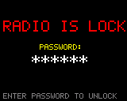 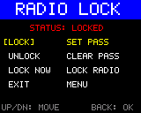 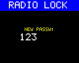       
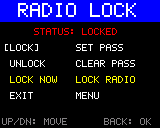 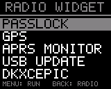 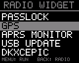

### Tracking

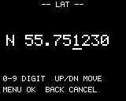 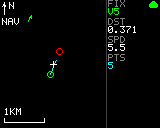 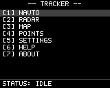       
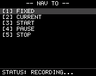 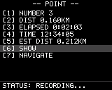 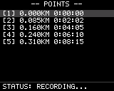       
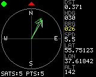 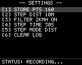 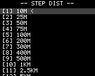  

### Real Photos

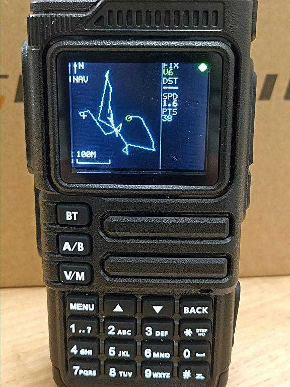     

---

## Credits & Acknowledgments

Приложения основаны на тулбоксе и кастомной прошивке [melidosian/h9toolbox](https://github.com/melidosian/h9toolbox).

---

**Автор**: [dkxce](https://github.com/dkxce)     
**Android**: [dkxce/tdh9android](https://github.com/dkxce/tdh9android)      
**Desktop**: [dkxce/tdh9desktop](https://github.com/dkxce/tdh9desktop)      
**Widgets**: [dkxce/tdh9apps](https://github.com/dkxce/tdh9apps)      
**Manual**: [dkxce/Tidradio-TD-H9](https://github.com/dkxce/Tidradio-TD-H9)
