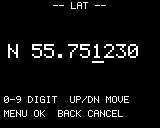
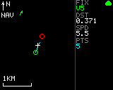
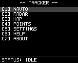
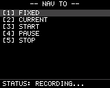
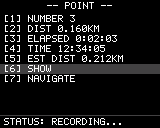
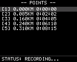
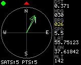
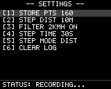
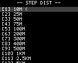

# Tracker – Navigation and Track Recording for TD-H9

[RU](README.md) | [EN](README.en.md)

Tracker app: shows current position, navigation to target
(fixed coordinates or stored point), records track in memory
radio and gives you a view on the radar and the map. Written for the TD-H9 platform

One appendix.**six** (`build.json`): visible`TRACKER`(menu/help/set up) and five hidden screens`.TRK *`which
switching.

## Opportunities

* **NAV TO**Objective: fixed coordinates (`.TRK FIXED`), current
  position (COPY), start of recording;
* **RADAR**- circular compass: red arrow to target, gray own
  course, field of values (DST, HDG, BRG, SPD, LAT, LON, ALT);
* **MAP**North-oriented map with track, start, goal, current
  position and scale (50 m.5000 km);
* **Points**List of saved points: distance and time from start
  clock, distance "from here", show on the map / navigate to it;
* **SETTINGS**the number of points saved, the recording step (by distance or
  time), course filter 2 km / h, log cleaning;
* background recording of the track directly from the receiver (see below).

## Keyboards

| keyboard | Action. |
| --- | --- |
| menu | in the menu - selection / confirmation;**on RADAR / MAP - recording / pause / continuation** |
| Up/down | menu list; transition RADAR MAP |
| 1..9. | Quick selection of menu items, entering numbers in editors |
| 5 | Points |
| 0 | RADAR/MAP: Full screen or split with value field |
| `*` | RADAR: Dial signatures (N E S W / 12 03 06 09 / 00 09 18 27); MAP: scale − |
| `#` | MAP: Scale + |
| 2 / 4 / 6 / 8 | MAP: pan the map up / left / right / down |
| Back | back on the menu / on RADAR and MAP - to the main menu TRACKER |

## Screens.

* **TRACKER**- Main menu:`NAVTO`, `RADAR`, `MAP`, `POINTS`,
  `SETTINGS`, `HELP`, `ABOUT`. Status line at the bottom:`IDLE`,
  `RECORDING...`, `PAUSED`.
* **NAV TO**- target selection:`FIXED`(coordinate editor),`CURRENT`(to copy the current position),`START`(start recording and leave)
  on RADAR,`PAUSE` / `RESUME`, `STOP`.
* **RADAR**North on top, red triangle-pointer N, green
  arrow to target (red without fix), gray own course (with a filter)
  2 km/h in motion only. Field on the right in split mode.
* **MAP**track blue, start green, target red, dot`SHOW`Lilac, his position with a white cross;`N`NAV pointer and arrow
  top left, scale bottom. You can move the map with keys.
  2/4/6/8 (panning around the center), scale`*`/`#`.
* **Points**- a list of points with distance / time from the start; at the point -
  full description`SHOW` / `NAVIGATE`.
* **SETTINGS** — `STORE PTS`(40...153),`STEP DIST`(10 m..5 km),`FILTER 2KMH ON/OFF`, `STEP TIME`(15...3600c),`STEP MODE`(DIST/TIME)`CLEAR LOG`. In DIST mode, the point is written no more than once in 15 seconds, even if
  The step is quicker.

## GPS and track recording

* Position, speed, course, satellites and time are taken from the NMEA stream.
  Which APRS radio modem puts in the ring`0x16634`team`0x10`).
  The module reads the ring itself.`trk_service`So it's only going on.
  While one of the tracker screens is open.
* Points are written in step (distance)`STEP_DIST`time`STEP_TIME`)
  stored`struct trk`in RAM`STATE_BYTES=0x6F4`): latitude, longitude
  and time from start. Maximum -`STORE PTS`points (by default 153);
  hardware-limit`MAX_PTS`= 153.
  It's starting.`base_dist`; when the track is overflowing (`cap`most
  old points are eliminated, and the base distance is replenished so that the distance
  It was still there.

## Modules and common code

| Module (build.json) | Hidden | What? |
| --- | --- | --- |
| `TRACKER` | no | menu, NAV TO, CURRENT, HELP, ABOUT |
| `.TRK FIXED` | yes | coordinater |
| `.TRK SETUP` | yes | recording |
| `.TRK RADAR` | yes | compass navigation |
| `.TRK MAP` | yes | track map |
| `.TRK POINTS` | yes | points and navigation |

The common code is divided by consumers so that the modules fit into 8 KB each.
detail[LIMITS. md](LIMITS.md). Main modules:

* `trk_core.c`state, NMEA, navigation mathematics, track recording,
  keys, lines (connected to all);
* `trk_track.c`Start/clean/track limit, distance and point time
* `trk_deg.c`- drawing coordinates;
* `trk_menu.c`- menu, status, messages;
* `trk_view.c`Primitives of drawing with cropping, value panel, status;
* `tracker.c` / `fixed.c` / `setup.c` / `radar.c` / `map.c` / `points.c`-
  the screens themselves;
* `trk.h`General condition and prototypes;
* `trk_end.c`- marker of the end of the body of the module.

## Installation

Build in CI (workflow)`Build myapps modules`:`build_one.py tracking`through`build.json`single`tracking.h9mod`with all six modules.
Installation on the radio - App Manager:

```
poetry run python td9_apps.py install tracking
```

After installation - application menu (holding)`#`?**TRACKER**.

## Assembly and limitations

* Flags:`-Oz -ffreestanding -fno-builtin -Wall -Werror`(anything)
  warning drops CI.
* Without libc and without floating arithmetic; global`const`- tables,
  variable data - in`struct trk`.
* Body of each module ≤ 8192 bytes; when overflowing`trk_open`show`MODULE TOO BIG +N`It doesn't start. Exact limits and techniques
  reduction[LIMITS. md](LIMITS.md).

## Compatibility

The modules are loaded into one RAM slot.`0x29F00..0x2BEFF`therefore simultaneously
Only one module can live in it.**Tracker and Tracker Saver are working
together**(tracksvr reading)`struct trk`tracker`0x2B7EC`but**not working
module`GPS` и `APRS`**: the launch of any of them is blocked`struct trk` (`0x2B7EC`), and the tracker points/coordinates are lost.
Use them in turn through the application menu (holding).`#`). Details about
reasons and about the frame addresses - in[LIMITS. md](LIMITS.md).

## Screenshots

     
     
  

## License.

Applications are based on tulbox and custom firmware[melidosian/h9toolbox](https://github.com/melidosian/h9toolbox).

---

**Author**: [dkxcece](https://github.com/dkxce)   
**Android**: [dkxce/tdh9android](https://github.com/dkxce/tdh9android)   
**Desktop**: [dkxce/tdh9desktop](https://github.com/dkxce/tdh9desktop)   
**Widgets**: [dkxce/tdh9apps](https://github.com/dkxce/tdh9apps)   
**Manual**: [dkxce/Tidradio-TD-H9](https://github.com/dkxce/Tidradio-TD-H9)