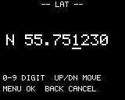
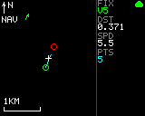
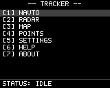
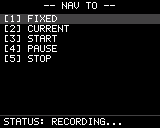
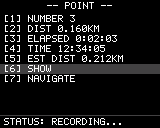
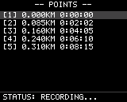
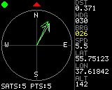
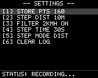
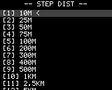

# TRACKER — навигация и запись трека для TD-H9

Приложение-трекер: показывает текущую позицию, навигацию до цели
(фиксированные координаты или сохранённая точка), записывает трек в память
рации и даёт просмотр на радаре и карте. Написано для платформы TD-H9

Одно приложение — **шесть модулей** (`build.json`): видимый `TRACKER`
(меню/справка/о настройке) и пять скрытых экранов `.TRK *`, которые
переключаются.

## Возможности

- **NAV TO** — цель: фиксированные координаты (`.TRK FIXED`), текущая
  позиция (COPY), старт записи;
- **RADAR** — круговой компас: красная стрелка к цели, серый собственный
  курс, поле значений (DST, HDG, BRG, SPD, LAT, LON, ALT);
- **MAP** — северо-ориентированная карта с треком, стартом, целью, текущей
  позицией и масштабной шкалой (50 м…5000 км);
- **POINTS** — список сохранённых точек: расстояние и время от старта,
  часы, расстояние «отсюда», показать на карте / навигировать к ней;
- **SETTINGS** — число сохраняемых точек, шаг записи (по расстоянию или
  времени), фильтр курса 2 км/ч, очистка лога;
- фоновая запись трека прямо с приёмника (см. ниже).

## Клавиши

| Клавиша | Действие |
|---|---|
| Menu | в меню — выбор/подтверждение; **на RADAR / MAP — запись/пауза/продолжение** |
| Up / Down | список меню; переход RADAR ↔ MAP |
| 1..9, 0 | быстрый выбор пункта меню, ввод цифр в редакторах |
| 5 | POINTS |
| 0 | RADAR / MAP: полный экран или split с полем значений |
| `*` | RADAR: подписи диаля (N E S W / 12 03 06 09 / 00 09 18 27); MAP: масштаб − |
| `#` | MAP: масштаб + |
| 2 / 4 / 6 / 8 | MAP: панорамирование карты вверх / влево / вправо / вниз |
| Back | назад по меню / на RADAR и MAP — к главному меню TRACKER |

## Экраны

- **TRACKER** — главное меню: `NAVTO`, `RADAR`, `MAP`, `POINTS`,
  `SETTINGS`, `HELP`, `ABOUT`. Строка статуса внизу: `IDLE`,
  `RECORDING...`, `PAUSED`.
- **NAV TO** — выбор цели: `FIXED` (редактор координат),
  `CURRENT` (скопировать текущую позицию), `START` (начать запись и уйти
  на RADAR), `PAUSE` / `RESUME`, `STOP`.
- **RADAR** — север сверху, красный треугольник-указатель N, зелёная
  стрелка к цели (красная без фикса), серый собственный курс (с фильтром
  2 км/ч — только в движении). Поле справа в split-режиме.
- **MAP** — трек голубым, старт зелёным, цель красной, точка `SHOW`
  сиреневой, своя позиция белым крестом; `N`-указатель и стрелка NAV
  сверху слева, шкала масштаба внизу. Карту можно сдвигать клавишами
  2/4/6/8 (панорамирование вокруг центра), масштаб — `*`/`#`.
- **POINTS** — список точек с расстоянием/временем от старта; на пункте —
  полное описание и `SHOW` / `NAVIGATE`.
- **SETTINGS** — `STORE PTS` (40…153), `STEP DIST` (10 м…5 км),
  `FILTER 2KMH ON/OFF`, `STEP TIME` (15…3600 с), `STEP MODE` (DIST / TIME),
  `CLEAR LOG`. В режиме DIST точка пишется не чаще раза в 15 с, даже если
  шаг пройден быстрее.

## GPS и запись трека

- Позиция, скорость, курс, спутники и время берутся из NMEA-потока,
  который APRS-модем рации кладёт в кольцо `0x16634` (команда `0x10`).
  Модуль сам читает кольцо в `trk_service`, поэтому запись идёт только
  пока открыт один из экранов трекера.
- Точки пишутся по шагу (расстояние `STEP_DIST` или время `STEP_TIME`),
  хранятся в `struct trk` в RAM (`STATE_BYTES=0x6F4`): широта, долгота
  и время от старта. Максимум — `STORE PTS` точек (по умолчанию 153;
  аппаратный предел `MAX_PTS` = 153).
  От старта ведётся `base_dist`; когда трек переполняется (`cap`), самые
  старые точки выбывают, а базовое расстояние пополняется, чтобы дистанция
  сохранялась.

## Модули и общий код

| Модуль (build.json) | Скрытый | О чём |
|---|---|---|
| `TRACKER` | нет | меню, NAV TO, CURRENT, HELP, ABOUT |
| `.TRK FIXED` | да | редактор координат цели |
| `.TRK SETUP` | да | настройки записи |
| `.TRK RADAR` | да | компас-навигация |
| `.TRK MAP` | да | карта трека |
| `.TRK POINTS` | да | точки и навигация к ним |

Общий код поделён по потребителям, чтобы модули влезли в 8 КиБ каждый;
подробности — в [LIMITS.md](LIMITS.md). Главные модули:

- `trk_core.c` — состояние, NMEA, навигационная математика, запись трека,
  клавиши, строки (подключается всеми);
- `trk_track.c` — старт/очистка/лимит трека, расстояния и время точек;
- `trk_deg.c` — отрисовка координат;
- `trk_menu.c` — меню, статус, сообщения;
- `trk_view.c` — примитивы рисования с обрезкой, панель значений, статус;
- `tracker.c` / `fixed.c` / `setup.c` / `radar.c` / `map.c` / `points.c` —
  сами экраны;
- `trk.h` — общее состояние и прототипы;
- `trk_end.c` — маркер конца тела модуля.

## Установка

Сборка идёт в CI (workflow `Build myapps modules`): `build_one.py tracking`
через `build.json` даёт один `tracking.h9mod` со всеми шестью модулями.
Установка на рацию — App Manager:

```
poetry run python td9_apps.py install tracking
```

После установки — меню приложений (удержание `#`) → **TRACKER**.

## Сборка и ограничения

- Флаги: `-Oz -ffreestanding -fno-builtin -Wall -Werror` (любое
  предупреждение валит CI).
- Без libc и без плавающей арифметики; глобальные `const`-таблицы,
  изменяемые данные — в `struct trk`.
- Тело каждого модуля ≤ 8192 байт; при переполнении `trk_open` показывает
  `MODULE TOO BIG +N` и не запускается. Точные лимиты и приёмы
  уменьшения — в [LIMITS.md](LIMITS.md).

## Совместимость

Модули загружаются в один RAM-слот `0x29F00..0x2BEFF`, поэтому одновременно
в нём может жить только один модуль. **TRACKER и TRACKER SAVER работают
вместе** (tracksvr читает `struct trk` трекера по `0x2B7EC`), но **не работают
вместе с модулями `GPS` и `APRS`**: запуск любого из них перекрывает
`struct trk` (`0x2B7EC`), и точки/координаты трекера пропадают.
Используйте их по очереди через меню приложений (удержание `#`). Подробнее о
причинах и о рамка-адресах — в [LIMITS.md](LIMITS.md).

## Скриншоты

         
         
    

## Лицензия


Приложения основаны на тулбоксе и кастомной прошивке [melidosian/h9toolbox](https://github.com/melidosian/h9toolbox).    

---

**Автор**: [dkxce](https://github.com/dkxce)     
**Android**: [dkxce/tdh9android](https://github.com/dkxce/tdh9android)      
**Desktop**: [dkxce/tdh9desktop](https://github.com/dkxce/tdh9desktop)      
**Widgets**: [dkxce/tdh9apps](https://github.com/dkxce/tdh9apps)      
**Manual**: [dkxce/Tidradio-TD-H9](https://github.com/dkxce/Tidradio-TD-H9)  
