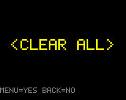
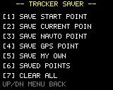
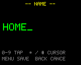
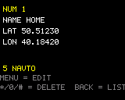
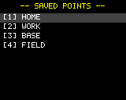
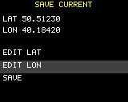

# TRACKER SAVER - save points for TD-H9

[RU](README.md) | [EN](README.en.md)

Application for saving and viewing user points on the radio
TD-H9. Points are taken from the tracker (current position, start, navigation point).
GPS) or manually entered, stored in resource flash and left behind
Turn off the radio. Works as a separate item on the application menu
deterrence`#`).

## Opportunities

* **Save Start Point**Maintain the start point of the recording (`slat/slon`);
* **Save the Current Point**maintain the current position;
* **Save NavTo Point**Maintain the navigation point (targets);
* **Save GPS Point**Maintain your current position (main/reserve);
* **Save My Own**Enter the name (T9) and coordinates manually, without a tracker;
* **Saved Points.**- list of saved points: viewing coordinates,
  name/coordinate editing, deletion, navigation to a point
* **Clear.**Erase all points (with confirmation).

Operations 1-4 take coordinates from the running tracker (see below);
tracker not running - the app shows`<LAUNCH TRACKER FIRST>`.
`Save My Own` и `Saved Points`They work autonomously.

## Keyboards

| keyboard | Action. |
| --- | --- |
| menu | selection/confirmation; in the editor, save |
| Up/down | navigation through menu and list of points |
| Back | back / cancel; in the main menu - exit from the application |
| 0-9 | T9-Name input; coordinate digits input |
| `*` / `#` | in the name - cursor left / right; in the list of points - delete |
| `[5]` | In view of the point - navigation to it (`NAVTO`) |

In the name editor, repeat the same key for ~0.5 seconds
cycling the group symbol (A/B/C), after a pause - a new letter with a cursor
Go ahead.`0`inserts a gap and`0`.

## Keeping the point

1. If the tracker launch (`Save Start/Current/NavTo/GPS`) - annex
   Shows the current coordinates and a three-line menu:`EDIT LAT`,
   `EDIT LON`, `SAVE`. Select the item and press Menu.
2. If`Save My Own`First enter the name (up to 8 characters), then
   latitude and longitude (decimal, micro-degrees).
3. `SAVE`The name (T9) is entered, the dot is written at the end of the table.

Records are written at the end without erasing the sector (append - programming).
in the first free cell). Editing and deleting rewrite sector
whole.

## Saved Points.

List shows up to 6 dots; Up/Down flips, off screen
The page is scrolling. At the selected point, press**menu**- opens
Viewing:

* `NUM`- dot number;
* `NAME`, `LAT`, `LON`- data;
* `[5] NAVTO`set the target point in the tracker (you need a running tracker);
* **menu**editing the name and coordinates;
* `*` / `0` / `#`Remove the point (with a shift to the left);
* **Back**- back to the list.

## Storage

The dot table is in resource flash.**sector`0x7FE000`**(4 KiB),
which does not use the runoff:

```
+0x00  0xD.. "DKXCETRACKSAVES"     magic (15 байт)
+0x0F  0xFF                        счётчик (не используется)
+0x10  запись 0: name[8] + lat(int32 LE) + lon(int32 LE)
+0x20  запись 1: ...
 ...   (до 255 записей, затем 0xFF)
```

* Each record is 16 bytes: name 8 + latitude`int32`micro-degrees
* longitude`int32`, micro-degrees);
* maximum**255**points`MAX_SAVES = (4096-16)/16`);
* number of points = scan of records from 0 to the first`0xFF`;
* Entry at the end - without erasing the sector (`NOR`, 1→0);
* Deletion / correction – erasing the sector and overwriting all records.

## Installation

The assembly is in CI.`build_one.py tracksvr`), finished module`myapps/tracksvr.h9mod`. Installation on the radio - App Manager:

```
poetry run python td9_apps.py install tracksvr
```

After installation - application menu (holding)`#`?**TRACKER SAVER**.

## Dot editing on PC (td9 tracksvr.py / td9 tracksvr.exe)

The same table can be read and written from a computer over Bluetooth.
without keyboard radio input:

```
# прочитать таблицу из рации в files.json (или --file свой)
poetry run python td9_tracksvr.py dump            # или: td9_tracksvr.exe dump

# вывести таблицу в консоль (без файла)
poetry run python td9_tracksvr.py show

# записать таблицу из JSON в рацию (стирает сектор и пишет целиком,
# перед стиранием сохраняет бэкап старого сектора)
poetry run python td9_tracksvr.py load [--file tracksvr_points.json]
```

File--`tracksvr_points.json`(by default, or custom)`--file`:

```
{
  "points": [
    {"name": "HOME", "lat": 55.7558, "lon": 37.6173},
    {"name": "WORK", "lat": 59.9390, "lon": 30.3158},
    {"name": "DATA", "lat": 51.1000, "lon": -1.2000}
  ]
}
```

* Coordinates - decimal degrees (radio stores micro-degrees, script)
  count ×1e6 and back again;
* name**8 bytes**(Cyrillic takes 2 bytes per letter – long names)
  This is a format limitation.`name[8]`);
* `dump`Maintain an accurate section of the sector in`--file`; `load`- overwrite
  whole sector, with the backup of the old`tracksvr-sector-backup.bin`or`--backup`).

## Assembly and limitations

* One module`tracksvr.c`), assembly -`build_one.py tracksvr`.
* Flags:`-Oz -ffreestanding -fno-builtin -Wall -Werror`(anything)
  warning drops CI. No libc and no floating arithmetic.
* Module body ≤ 6380 bytes; tracker state reads from RAM slot
  ?`struct trk_hdr`along`0x2B7EC`compatible with the tracker`TRK`). Not
  cover`struct trk`The module should not be longer.`0x2B7EC − 0x29F00`= 6380 bytes (otherwise the tracker state will be lost when downloading).
* Flash recording – through stock functions`STOCK_ERASE`/`STOCK_PROGRAM`(No entry in the h9mod API).

## Compatibility

The module is loaded into the same RAM slot.`0x29F00..0x2BEFF`as well as the tracker and
other applications, so only one module can live in the slot at the same time.

**TRACKER SAVER is working with`TRACKER`**(Save Start/Current/NavTo/GPS)
read`struct trk`tracker`0x2B7EC`but**Does not work with modules`GPS` и `APRS`**: when they are launched, they are closed`struct trk`and coordinates
The tracker becomes unavailable`<NO FIX>` / `<LAUNCH TRACKER FIRST>`?
The GPS module can erase the dot table or state. Use them on
queues through the application menu (holding)`#`). Point table is stored on
flash chip resources (sector)`0x7FE000`) and not lost on switching
applications.

## Screenshots

     
  

## Credits & Acknowledgments

Applications are based on tulbox and custom firmware[melidosian/h9toolbox](https://github.com/melidosian/h9toolbox).

---

**Author**: [dkxcece](https://github.com/dkxce)   
**Android**: [dkxce/tdh9android](https://github.com/dkxce/tdh9android)   
**Desktop**: [dkxce/tdh9desktop](https://github.com/dkxce/tdh9desktop)   
**Widgets**: [dkxce/tdh9apps](https://github.com/dkxce/tdh9apps)   
**Manual**: [dkxce/Tidradio-TD-H9](https://github.com/dkxce/Tidradio-TD-H9)