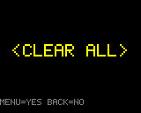
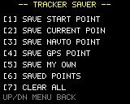
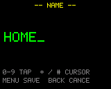
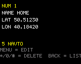
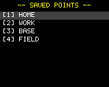
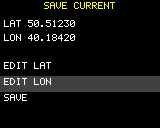

# TRACKER SAVER — сохранение точек для TD-H9

[RU](README.md) | [EN](README.en.md)      

Приложение для сохранения и просмотра пользовательских точек на рации
TD-H9. Точки берутся из трекера (текущая позиция, старт, точка навигации,
GPS) или вводятся вручную, хранятся в resource flash и остаются после
выключения рации. Работает как отдельный пункт меню приложений
(удержание `#`).

## Возможности

- **Save Start Point** — сохранить точку старта записи (`slat/slon`);
- **Save Current Point** — сохранить текущую позицию;
- **Save NavTo Point** — сохранить точку навигации (цели);
- **Save GPS Point** — сохранить текущую позицию (резерв/main);
- **Save My Own** — ввести имя (T9) и координаты вручную, без трекера;
- **Saved Points** — список сохранённых точек: просмотр координат,
  редактирование имени/координат, удаление, навигация к точке;
- **Clear All** — стереть все точки (с подтверждением).

Операции 1–4 берут координаты из запущенного трекера (см. ниже); если
трекер не запущен — приложение показывает `<LAUNCH TRACKER FIRST>`.
`Save My Own` и `Saved Points` работают автономно.

## Клавиши

| Клавиша | Действие |
|---|---|
| Menu | выбор/подтверждение; в редакторе — сохранить |
| Up / Down | навигация по меню и списку точек |
| Back | назад / отмена; в главном меню — выход из приложения |
| 0–9 | T9-ввод имени; ввод цифр координат |
| `*` / `#` | в имени — курсор влево / вправо; в списке точек — удалить |
| `[5]` | в просмотре точки — навигация к ней (`NAVTO`) |

В редакторе имени повтор одной и той же клавиши в течение ~0,5 с
циклирует символ группы (A/B/C), после паузы — новая буква с курсором
вперёд. `0` вводит пробел и `0`.

## Сохранение точки

1. Если пуск из трекера (`Save Start/Current/NavTo/GPS`) — приложение
   показывает текущие координаты и трёхстрочное меню: `EDIT LAT`,
   `EDIT LON`, `SAVE`. Выберите пункт и нажмите Menu.
2. Если `Save My Own` — сначала вводится имя (до 8 символов), потом
   широта и долгота (десятичные, микро-градусы).
3. `SAVE` — вводится имя (T9), точка пишется в конец таблицы.

Записи дописываются в конец без стирания сектора (append — программирование
в первую свободную ячейку). Редактирование и удаление переписывают сектор
целиком.

## Saved Points

Список показывает до 6 точек; Up/Down листают, за пределами экрана
страница прокручивается. На выбранной точке нажмите **Menu** — откроется
просмотр:

- `NUM` — номер точки;
- `NAME`, `LAT`, `LON` — данные;
- `[5] NAVTO` — установить точку целью в трекере (нужен запущенный трекер);
- **Menu** — редактирование имени и координат;
- `*` / `0` / `#` — удалить точку (со сдвигом влево);
- **Back** — вернуться к списку.

## Хранение

Таблица точек лежит в resource flash, **сектор `0x7FE000`** (4 КиБ),
который сток не использует:

```
+0x00  0xD.. "DKXCETRACKSAVES"     magic (15 байт)
+0x0F  0xFF                        счётчик (не используется)
+0x10  запись 0: name[8] + lat(int32 LE) + lon(int32 LE)
+0x20  запись 1: ...
 ...   (до 255 записей, затем 0xFF)
```

- Каждая запись — 16 байт: имя 8 + широта (`int32`, микро-градусы)
  + долгота (`int32`, микро-градусы);
- максимум **255** точек (`MAX_SAVES = (4096-16)/16`);
- число точек = скан записей от 0 до первой `0xFF`;
- запись в конец — без стирания сектора (`NOR`, 1→0);
- удаление/правка — стирание сектора и перезапись всех записей.

## Установка

Сборка идёт в CI (`build_one.py tracksvr`), готовый модуль —
`myapps/tracksvr.h9mod`. Установка на рацию — App Manager:

```
poetry run python td9_apps.py install tracksvr
```

После установки — меню приложений (удержание `#`) → **TRACKER SAVER**.

## Редактирование точек на ПК (td9_tracksvr.py / td9_tracksvr.exe)

Ту же таблицу можно читать и записывать с компьютера по Bluetooth —
без ввода с клавиатуры рации:

```
# прочитать таблицу из рации в files.json (или --file свой)
poetry run python td9_tracksvr.py dump            # или: td9_tracksvr.exe dump

# вывести таблицу в консоль (без файла)
poetry run python td9_tracksvr.py show

# записать таблицу из JSON в рацию (стирает сектор и пишет целиком,
# перед стиранием сохраняет бэкап старого сектора)
poetry run python td9_tracksvr.py load [--file tracksvr_points.json]
```

Файл — `tracksvr_points.json` (по умолчанию, или кастомный `--file`):

```json
{
  "points": [
    {"name": "HOME", "lat": 55.7558, "lon": 37.6173},
    {"name": "WORK", "lat": 59.9390, "lon": 30.3158},
    {"name": "DATA", "lat": 51.1000, "lon": -1.2000}
  ]
}
```

- Координаты — десятичные градусы (рация хранит микро-градусы, скрипт
  пересчитывает ×1e6 и обратно);
- имя — до **8 байт** (кириллица занимает 2 байта на букву — длинные имена
  усекаются, это ограничение формата `name[8]`);
- `dump` — сохранить точный срез сектора в `--file`; `load` — перезаписать
  весь сектор, с бэкапом старого в `tracksvr-sector-backup.bin` (или `--backup`).

## Сборка и ограничения

- Один модуль (`tracksvr.c`), сборка — `build_one.py tracksvr`.
- Флаги: `-Oz -ffreestanding -fno-builtin -Wall -Werror` (любое
  предупреждение валит CI). Без libc и без плавающей арифметики.
- Тело модуля ≤ 6380 байт; состояние трекера читается из RAM-слота
  (`struct trk_hdr` по `0x2B7EC`, совместим с трекером `TRK`). Чтобы не
  перекрыть `struct trk`, модуль должен быть не длиннее `0x2B7EC − 0x29F00`
  = 6380 байт (иначе при загрузке затрется состояние трекера).
- Запись flash — через стоковые функции `STOCK_ERASE`/`STOCK_PROGRAM`
  (нет записи в h9mod API).

## Совместимость

Модуль загружается в тот же RAM-слот (`0x29F00..0x2BEFF`), что и трекер и
другие приложения, поэтому одновременно в слоте может жить только один модуль.

**TRACKER SAVER работает вместе с `TRACKER`** (пункты Save Start/Current/NavTo/GPS
читают `struct trk` трекера по `0x2B7EC`), но **не работает вместе с модулями
`GPS` и `APRS`**: при их запуске перекрывается `struct trk`, и координаты
трекера становятся недоступны (`<NO FIX>` / `<LAUNCH TRACKER FIRST>`), а
GPS-модуль может затереть таблицу точек или состояние. Используйте их по
очереди через меню приложений (удержание `#`). Point table хранится на
флеш-чипе ресурсов (сектор `0x7FE000`) и не теряется при переключении
приложений.

## Скриншоты

     
       

##  Credits & Acknowledgments

Приложения основаны на тулбоксе и кастомной прошивке [melidosian/h9toolbox](https://github.com/melidosian/h9toolbox).    

---

**Автор**: [dkxce](https://github.com/dkxce)     
**Android**: [dkxce/tdh9android](https://github.com/dkxce/tdh9android)      
**Desktop**: [dkxce/tdh9desktop](https://github.com/dkxce/tdh9desktop)      
**Widgets**: [dkxce/tdh9apps](https://github.com/dkxce/tdh9apps)      
**Manual**: [dkxce/Tidradio-TD-H9](https://github.com/dkxce/Tidradio-TD-H9)  